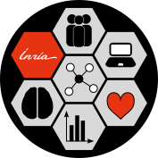

# Hackathon — Software Mention Extraction

**Séminaire Santé Numérique 2026** · Campus Biaggi, Marseille · Salle Australie · 14–15 October 2026

Organisers: Luca Foppiano (ScienciaLAB, Inria) · Clémence Sebe (LISN, Université Paris-Saclay)

<p>
  
  &nbsp;&nbsp;
  
  &nbsp;&nbsp;
  
</p>

## The goal

> **Extract and analyse the software names mentioned in PEPR Santé Numérique publications.**

Software is central to research but rarely **cited** formally. Most of it shows up as informal mentions in the text ("analyses were performed with **SPSS** v25 and **R** 4.3…"), so citation indexes miss it. Finding those mentions lets us track research practices, tell software that is *created* apart from software that is merely *used*, and discover new tools.

Three questions to guide your two days:

1. **What new analyses** can we run on these publications?
2. **Which methods** work, and which fail?
3. **What other data** could we bring in?

## Quick links

| | |
|---|---|
| 📊 **Datasets** | [`datasets/README.md`](datasets/README.md): the PEPR corpus plus the annotated corpora (SoftCite, SoMeSci, SoFAIR, BioToFlow, CPL-Article) |
| 🤖 **Models & tools** | [`models/README.md`](models/README.md): Softcite software-mentions, CoPaLink, Baguette via `lm-inference`, OpenAlex, HAL API |
| 📓 **Starter notebook** | [`notebooks/softcite_analysis.ipynb`](notebooks/softcite_analysis.ipynb): Softcite-style analysis of extracted mentions |
| 👥 **Group work** | [`groups/`](groups/README.md): one folder per group, plus a template |
| 💻 **Environment** | [`environment/`](environment/README.md): Biosphere Jupyter VM, opencode + Albert API |
| 🎞️ **Opening slides** | [`presentation/`](presentation/README.md) |
| 🤗 **PEPR data** | [HackatonSanteNumerique/pepr-hal-data](https://huggingface.co/HackatonSanteNumerique/pepr-hal-data): GROBID outputs + Softcite predictions |

## Getting started

Work on your laptop or on a Jupyter VM on Biosphere, the IFB cloud: see [`environment/`](environment/README.md). **Ask to join the Biosphere group before the hackathon**, because requests are approved by hand.

The repo is a [uv](https://docs.astral.sh/uv/) project:

```bash
git clone https://github.com/HackathonSanteNumerique/hackaton-sante-numerique-2026.git
cd hackaton-sante-numerique-2026
uv sync

# Download the PEPR corpus (GROBID outputs + Softcite predictions, ~112 MB) into data/ (git-ignored)
# or only the Softcite output the notebook needs: --pattern "softcite/*"
uv run python scripts/download_pepr.py

# Open the starter notebook
uv run jupyter lab notebooks/softcite_analysis.ipynb
```

Then copy [`groups/_template`](groups/_template/README.md) to `groups/<your-group>` and start hacking. Vibe-coding is welcome: [opencode + Albert API](environment/README.md#vibe-coding-with-opencode--albert-api) works on Biosphere, or use your favourite assistant.

## Ideas if you don't know where to start

**🔬 Extraction**
- Run the existing approaches on the PEPR data and **compare** results
- Separate software that is **created** from software that is **used**
- Apply a **classification model** to the predictions of the BioToFlow-trained model

**📊 Analysis**
- Which software dominates? By research axis, lab, year?
- Open source vs. proprietary, languages, linked repositories
- Cross with [OpenAlex](https://openalex.org/): author ↔ software networks

**🛠️ Tools**
- Visualisation, dashboards, search over mentions…

**🖥️ Infrastructure**
- Deploy Softcite on a Biosphere GPU VM (or on Grid'5000) and document the procedure: how hard is it to access and use these services?

### Evaluation: an open question

There are no gold annotations on the PEPR corpus. Ways to judge extraction quality:

- agreement between models (SoftCite vs. CoPaLink vs. Baguette)
- manual annotation of a **small sample**
- transfer from the annotated corpora

To start, [`evaluation/`](evaluation/README.md) scores Baguette and Softcite against SoMeSci, a corpus annotated by hand ([results](evaluation/RESULTS.md)).

Any proposal is welcome!

## Schedule

**Tuesday 14 October**

| Time | Activity |
|---|---|
| 9:00 – 9:30 | Presentations: SoftCite & HAL (Luca) · BioToFlow & NER (Clémence) · the hackathon |
| 9:30 – 9:45 | **Form groups** (3–5 people, mixed profiles: NLP, dev, health, data) |
| 9:45 – 11:00 | **Brainstorming**: pick a topic |
| 11:00 – 11:15 | *Break* |
| 11:15 – 12:15 | **Quick share**: 5 min per group |
| 12:15 – 13:45 | *Lunch* |
| 13:45 – 15:45 | Hacking |
| 15:45 – 16:00 | *Break* |
| 16:00 – 18:00 | Hacking |

🎯 **By the end of the morning**, every group knows what it will test in the afternoon.

**Wednesday 15 October**

| Time | Activity |
|---|---|
| 9:00 – 10:30 | Hacking: wrap-up |
| 10:30 – 11:00 | *Break* |
| 11:00 – 12:00 | **Group presentations** & discussion |
| 12:00 – 12:15 | Conclusion / closing |

## What we expect from each group

A short presentation on Wednesday, even if "it didn't work": the **question**, the **data & methods**, the **results**, the **difficulties** and **next steps**. Please push your code and notebooks under [`groups/`](groups/README.md) 🙏

## Repository layout

```
├── datasets/        dataset catalogue
├── models/          models & tools
├── environment/     Biosphere VM, opencode + Albert API
├── notebooks/       starter notebooks
├── scripts/         shared helpers (e.g. download_pepr.py)
├── data/            local downloads (git-ignored)
├── groups/          one folder per group
└── presentation/    opening slides (Marp) and logos
```

## Contacts

Luca Foppiano · Clémence Sebe
